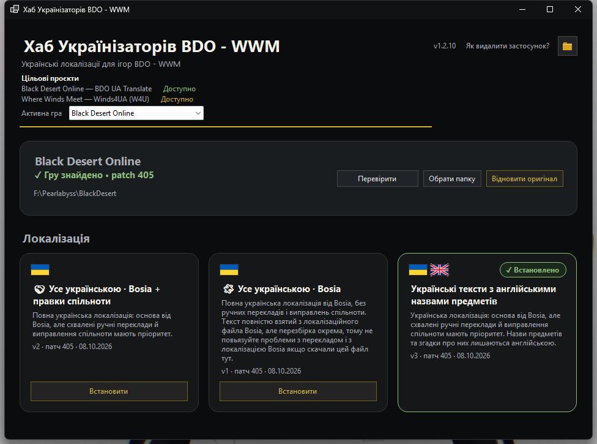
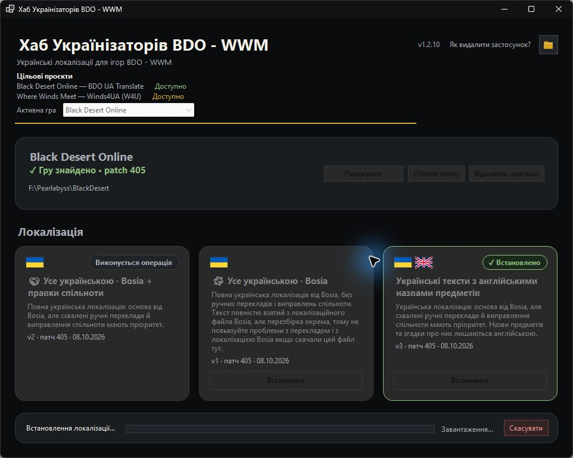
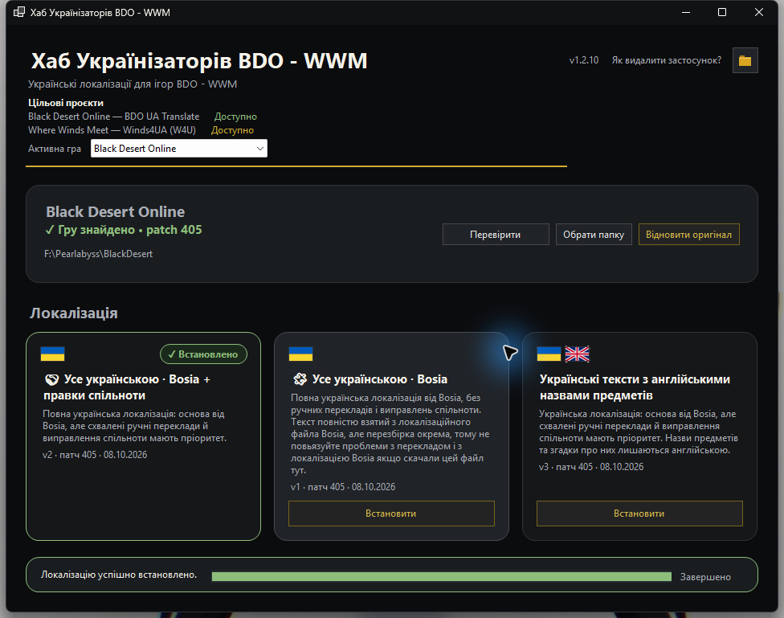

<p align="center">
  
</p>

<h1 align="center">Хаб Українізаторів BDO - WWM</h1>

<p align="center">
  Українські локалізації для ігор BDO - WWM
</p>

<p align="center">
  <a href="https://github.com/merelyigor/ua-localization-hub/actions/workflows/ci.yml"></a>
</p>

---

## Про проект

**Хаб Українізаторів BDO - WWM** — Windows-хаб для встановлення та керування українськими локалізаціями [Black Desert Online](https://www.blackdesertonline.com/) і [Where Winds Meet](https://www.wherewindsmeetgame.com/). Для BDO доступна інтеграція BDO UA Translate; для WWM — Windows multi-layout інтеграція Winds4UA.

Застосунок використовує окремі публічні API та install flows [BDO UA Translate](https://bdo-ua.com.ua/) і [Winds4UA (W4U)](https://winds4ua.com.ua/). Перелік WWM режимів є динамічним; встановлюються лише режими, які свіжий API позначає доступними та для яких надає перевірений package.

### Цільові проєкти локалізації

| Гра | Проєкт | Статус |
|---|---|---|
| Black Desert Online | [BDO UA Translate](https://bdo-ua.com.ua/) | Доступно та інтегровано |
| Where Winds Meet (Windows) | [Winds4UA (W4U)](https://winds4ua.com.ua/) | Доступно; режими визначає API |

Хаб розпізнає Windows-інсталяції WWM за `Engine\Binaries\Win64r\wwm.exe` і однією чи обома locale-розкладками: `Package\HD\oversea\locale` або `LocalData\Patch\HD\oversea\locale`. Steam підтверджується відповідним AppID `3564740` у Steam manifest; Epic — matching Epic Launcher `.item` metadata з WWM product identity. Інші валідні roots показуються як Where Winds Meet без непідтвердженої launcher-позначки. Встановлення, оновлення та відновлення підтримують однозначно визначену target layout: Steam/Epic використовують Package, а невідомий source — єдину знайдену layout. Для UnknownWindows із двома layouts зміни блокуються; Official Launcher provenance автоматично не заявляється без надійних launcher metadata. Android не підтримується цим Windows-застосунком. API не підтверджує сумісність перекладу з конкретним game build, тому перед встановленням Hub показує нейтральний запит підтвердження. Відновлення WWM повертає точний стан файлів до першої зміни Hub; це не гарантія повернення до stock-файлів гри.

Проєкт є волонтерським та підтримується спільнотою.

### Можливості

- Автоматичний пошук встановленої гри
- Встановлення та оновлення локалізації з перевіркою цілісності пакета
- Для BDO перевіряються metadata релізу та SHA-256 файлу локалізації; для WWM перевіряються розмір і SHA-256 ZIP, а два керовані файли змінюються однією транзакцією з rollback
- Кілька режимів локалізації на вибір
- Для BDO — відновлення офіційного файлу або перевіреного локального snapshot; для WWM — повернення точного стану до першої зміни Хабом
- Захист файлів гри: бекапи, атомарна заміна, rollback при помилках
- Детальні логи для діагностики
- Робота в системному треї
- Фонове відстеження оновлень
- Windows autostart і запуск у фоновому режимі
- Інформаційне сповіщення про нове оновлення локалізації BDO та окреме сповіщення про нову версію самого застосунку

### Трей і фоновий режим

Звичайне натискання **X** ховає **Хаб Українізаторів BDO - WWM** у системний трей, не завершуючи програму. Меню іконки трея містить **"Відкрити"**, **"Перевірити зараз"**, **"Запускати разом із Windows"** і **"Вихід"**. Подвійний клік по іконці відновлює застосунок, а **"Вихід"** повністю завершує його.

За бажанням застосунок запускається разом із Windows у фоновому режимі. Коли вікно видиме, перевірки API виконуються частіше; у фоновому режимі — навмисно рідше, щоб заощаджувати ресурси. Прихований застосунок відстежує важливі зміни керованих файлів вибраної гри. Хаб додатково перевіряє наявність новішої версії приблизно кожні 5 хвилин; якщо нову версію знайдено у прихованому режимі, Windows показує одне сповіщення для цієї версії. Сповіщення про нову локалізацію зараз надсилається для BDO; перевірка стану WWM оновлює його картки без такого окремого сповіщення. Після відкриття програми доступна звичайна кнопка оновлення. Пункт **"Перевірити зараз"** перевіряє локалізаційний фід вибраної гри та доступність нової версії застосунку. Сповіщення є інформаційним і не запускає оновлення автоматично; для відкриття використовуйте трей.

Фоновий режим розрахований на роботу без помітного навантаження на комп’ютер. На наведеному вимірюванні в Диспетчері завдань Хаб Українізаторів BDO - WWM споживає **0% CPU**, близько **17,6 МБ оперативної пам’яті**, а активність диска та мережі становить **0 Мбіт/с**. Фактичні показники можуть трохи відрізнятися залежно від системи та моменту перевірки, але застосунок виконує фоновий моніторинг ощадливо й не заважає повсякденній роботі.


---

## Завантаження

Офіційні збірки Хабу Українізаторів BDO - WWM публікуються на сторінці **[GitHub Releases](https://github.com/merelyigor/ua-localization-hub/releases)**.

Завантажте canonical ZIP-архів:

```
BDO-WWM-UAClient-vX.Y.Z-win-x64.zip
```

Public release також містить legacy compatibility ZIP `BDO-UA-Client-vX.Y.Z-win-x64.zip` для вже опублікованих клієнтів. Canonical bundle містить `BDO-WWM-UAClient.exe`, а legacy bundle — той самий виконуваний файл під ім'ям `BDO-UA-Client.exe`; кожен архів має власні manifest, SHA sums та release notes. Project-created nested ZIP не використовується.

Для роботи не потрібно встановлювати .NET Runtime — застосунок самодостатній (self-contained).

### Системні вимоги

- Windows 10/11 x64
- Підключення до інтернету
- Встановлена Black Desert Online та/або Windows-версія Where Winds Meet

---

## Windows SmartScreen

Хаб Українізаторів BDO - WWM наразі не підписаний комерційним сертифікатом підпису коду (code-signing certificate). Тому Windows SmartScreen може показати попередження **"Невідомий видавець"** при першому запуску.

Наявність цього попередження сама по собі не означає, що файл є шкідливим. Windows може показувати SmartScreen для застосунків без впізнаваного цифрового підпису видавця або з недостатньою репутацією.

### Як запустити

1. Завантажте canonical ZIP тільки з офіційної сторінки [GitHub Releases](https://github.com/merelyigor/ua-localization-hub/releases) репозиторію `merelyigor/ua-localization-hub`.
2. Розпакуйте **BDO-WWM-UAClient.exe**.
3. Запустіть **BDO-WWM-UAClient.exe**.
4. Якщо з'явилось вікно SmartScreen, натисніть **"Докладніше"**.


5. Перевірте, що вказано **BDO-WWM-UAClient.exe**.
6. Натисніть **"Виконати"**.


> **Увага:** не натискайте "Виконати" для файлів, завантажених з невідомих сторонніх джерел. Використовуйте тільки офіційну сторінку релізів.

---

## Як видалити Хаб Українізаторів BDO - WWM

Хаб Українізаторів BDO - WWM — portable-застосунок: він не встановлюється у Windows через MSI/MSIX або Windows Installer, тому окремого деінсталятора у **Programs and Features** немає. Поточне canonical-ім'я виконуваного файла — **`BDO-WWM-UAClient.exe`**; legacy-ім'я **`BDO-UA-Client.exe`** залишається для compatibility bundle.

### Звичайне видалення

1. Якщо увімкнено автозапуск, спочатку вимкніть його в меню іконки трея **«Запускати разом із Windows»**.
2. Повністю завершіть застосунок через меню трея **«Вихід»**. Натискання **X** лише ховає програму у трей і не завершує процес.
3. Видаліть файл **`BDO-WWM-UAClient.exe`**.

### Повне очищення даних

Окремо від EXE можуть залишатися технічні дані застосунку у `%LocalAppData%\BDO-UA-Client`: конфігурація, логи, стан встановлення, тимчасові файли cache, резервні копії та дані сесій оновлення. Цей шлях збережено для сумісності. Якщо ці дані більше не потрібні, після повного завершення застосунку можна видалити всю цю папку. Логи та резервні копії можна залишити, якщо вони потрібні для діагностики або відновлення.

Видалення застосунку або його папки даних не відновлює і не видаляє застосовану локалізацію. Перед видаленням за потреби використайте дію **«Відновити оригінал»**. Для WWM вона повертає збережений точний стан файлів до першої зміни Хабом у поточному циклі; це не гарантія Steam stock bytes.

---

## Пошук гри

Обрану гру Hub шукає відповідним detector-ом. Для BDO зберігається наявний пошук і відображення patch із `ads_files`. Для WWM потрібен `Engine/Binaries/Win64r/wwm.exe` та хоча б одна Windows locale-розкладка. Steam автоматично визначається за library metadata і AppID `3564740` manifest; Epic — за matching `.item` manifest та WWM product identity. Інші валідні roots можна знайти ручним bounded search. Показаний Steam build — лише інформаційна ознака, не підтвердження сумісності.

> ✓ Гру знайдено • patch 398

Якщо патч визначити неможливо, залишається звичайний статус **✓ Гру знайдено**.

Якщо гра не знайдена автоматично, скористайтеся кнопкою автоматичного пошуку або оберіть папку кнопкою **"Обрати папку"**. Коли гра вже знайдена, кнопка **"Перевірити"** запускає її повторну перевірку.

Для ручного вибору BDO можна вказати кореневу папку гри або її безпосередню батьківську папку з однією знайденою грою. Для WWM можна вказати сам корінь або будь-яку батьківську папку: Hub шукає валідні корені рекурсивно лише всередині вибраного дерева, не переходить через junction/symlink і не обирає автоматично між кількома результатами. Для впізнавання потрібні `Engine/Binaries/Win64r/wwm.exe` і одна чи обидві відомі locale-розкладки. Steam підтверджується matching Steam manifest, Epic — matching Epic `.item` metadata та WWM product identity; без таких доказів показується загальна назва Where Winds Meet. Official Launcher автоматично не визначається. Встановлення/оновлення/відновлення доступні для однозначно визначеної цільової розкладки; якщо невідоме джерело має обидві розкладки, зміни заблоковані до ручного вибору однозначної інсталяції.

---

## Вибір режиму локалізації



Застосунок отримує список режимів з API відповідної гри. Режими можуть змінюватися — конкретний перелік залежить від поточних серверних даних. Hub показує лише режими, для яких доступна придатна до встановлення metadata; недоступні або неповні WWM-режими приховані.

- Оберіть одну з доступних карток режиму; вся картка є клікабельною
- Картка BDO показує metadata релізу, зокрема версію, patch і дату; WWM-картка показує назву, опис/аудиторію та доступний стан і дію
- Точний встановлений реліз позначено: **✓ Встановлено**; для новішого релізу того самого режиму доступна дія **Оновити**
- Клавіша `Tab` переходить між доступними елементами; `Space` або `Enter` активує сфокусовану дію

У списку відображаються лише режими, для яких сервер наразі надає доступний реліз і валідний пакет.

---

## Встановлення

### Black Desert Online

1. Переконайтеся, що BDO знайдено, та оберіть режим.
2. Натисніть **"Встановити"** або **"Оновити"**. Перед транзакцією Hub повторно перевіряє актуальні metadata вибраного режиму та сумісність із поточним офіційним patch BDO.
3. Дочекайтеся завершення.

Hub завантажує immutable URL релізу, перевіряє SHA-256, створює потрібні резервні копії, замінює файл локалізації та перевіряє результат.

### Where Winds Meet

1. Переконайтеся, що знайдено підтримувану інсталяцію Where Winds Meet, та оберіть доступний режим Winds4UA. Хаб підтримує Package target для підтверджених Steam/Epic інсталяцій і однозначно виявлені Windows layouts для невідомого launcher provenance; Official Launcher provenance автоматично не заявляється.
2. Натисніть **"Встановити"** або **"Оновити"**. Перед кожною операцією Hub повторно запитує latest API та бере пакет саме з metadata вибраного `slug + variant`.
3. Через відсутність у API підтвердження сумісності з конкретним game build Hub показує нейтральне підтвердження перед будь-якою зміною файлів. Після підтвердження ZIP перевіряється за розміром і SHA-256; Hub готує довірений pre-Hub snapshot і встановлює два керовані файли як одну транзакцію з перевіркою та rollback.

Натискання **"Назад"** у підтвердженні скасовує операцію до завантаження та зміни файлів.

Пакет Winds4UA має Package-relative entries; Hub перевіряє їх і відображає до вибраної цільової layout, а не розпаковує ZIP безпосередньо в гру. Під час операції картки режимів блокуються, а нижня панель показує поточний етап, прогрес і кнопку **"Скасувати"**:



При успішному встановленні:

> Локалізацію успішно встановлено.



---

## Перемикання режимів


Якщо вже встановлено один режим локалізації, можна обрати інший доступний режим та натиснути **"Встановити"**. Новий режим замінить поточний через відповідний для гри install flow.

Під час перемикання поточний встановлений режим залишається позначеним, а вибраний режим показує стан операції:


Після завершення новий режим стає встановленим, а попередній знову доступний для вибору:


Якщо для поточного встановленого режиму доступний новіший реліз, та сама основна кнопка змінює напис на **"Оновити"**. Окремої другої кнопки оновлення немає.

Якщо обраний реліз уже точно встановлено, основна кнопка **"Встановити"** неактивна.

---

## Оновлення локалізацій

### BDO

Нові переклади BDO публікуються на сайті [bdo-ua.com.ua](https://bdo-ua.com.ua/). Після виходу нового patch оновлення зазвичай готується та публікується в четвер після перевірки й фіксації перекладу; це типовий графік BDO, а не гарантія.

Перед встановленням або оновленням Hub отримує свіжі metadata вибраного режиму та блокує операцію, якщо реліз несумісний із поточним офіційним patch.

### Where Winds Meet

Доступність режимів і пакетів визначає API [Winds4UA](https://winds4ua.com.ua/); окремий графік публікації README не обіцяє. Перед кожною установкою/оновленням Hub повторно запитує `/api/public/v1/releases/latest`; збій або недоступність пакета блокує запис без використання застарілих metadata. API не пов'язує реліз із конкретним game build, тому Hub не заявляє про таку сумісність і просить нейтральне підтвердження перед зміною файлів.

Для встановленого режиму з новішим релізом картка показує **"Доступне оновлення"**, а основна кнопка змінюється на **"Оновити"**:


Для BDO режим без опублікованого релізу для поточного patch не показується серед доступних у Хабі. Для WWM приховані режими, які API позначив недоступними або для яких немає одного валідного matching package. В обох випадках картка з'являється автоматично, коли відповідний API надає придатний реліз.

Для BDO несумісність із відомим офіційним patch блокує встановлення. Для WWM API наразі не підтверджує сумісність із конкретним build; замість вигаданого hard compatibility check Hub запитує явне підтвердження.

---

## Відновлення локалізації

Для BDO натисніть **"Відновити оригінал"**: Hub завантажить офіційний файл або використає придатний локальний snapshot згідно з BDO-політикою. У WWM кнопка з тією самою назвою повертає точні bytes двох керованих файлів із довіреного першого pre-Hub snapshot; якщо файл до змін був відсутній — Hub видаляє створений файл. Це не гарантує stock bytes. Snapshot прив'язаний до root, target layout та інсталяційного fingerprint; для Steam додатково діє build-staleness gate. Restore блокується при зовнішній зміні файлів або невідповідності binding.

Під час відновлення нижня панель показує етап операції, прогрес і доступну кнопку скасування:


Після успішного завершення застосунок підтверджує завершення відновлення:


---

## Стан

Блок стану показує поточну інформацію:

- **Стан локалізації** — фактичний стан керованого файла BDO або двох керованих файлів WWM та поточного вибору:
  - ✓ Обраний режим уже встановлено
  - Обрано інший режим локалізації
  - Доступне оновлення локалізації
  - Локалізацію не встановлено
- **Встановлено зараз** — що фізично встановлено (режим, версія, дата)
- **Обрано для встановлення** — який режим буде встановлено після натискання основної кнопки

---

## Логи

Логи зберігаються у:

```
%LocalAppData%\BDO-UA-Client\logs\
```

Логи допомагають при діагностиці проблем. При зверненні з питаннями додайте вміст файлу логу за відповідний день.

---

## Питання та проблеми

1. Перевірте [логи](#логи) — там можуть бути деталі помилки
2. Переконайтеся, що гра знайдена правильно
3. Спробуйте перезапустити застосунок
4. Зверніться до спільноти BDO UA

---

## Пов'язані проєкти

| Проєкт | Опис |
|---|---|
| [bdo-ua.com.ua](https://bdo-ua.com.ua/) | Проєкт українізації Black Desert Online |
| [bdo-ua.com.ua/download](https://bdo-ua.com.ua/download) | Сторінка завантаження локалізації |
| [winds4ua.com.ua](https://winds4ua.com.ua/) | Проєкт Winds4UA для Where Winds Meet |

---

## Технічна документація

Для розробників: [docs/index.md](docs/index.md)

---

## Подяки

- [BDO UA](https://bdo-ua.com.ua/) — проєкт українізації Black Desert Online
- Перекладачі та спільнота за тестування та вдосконалення локалізації
- Bosia — за створення основи українського перекладу
